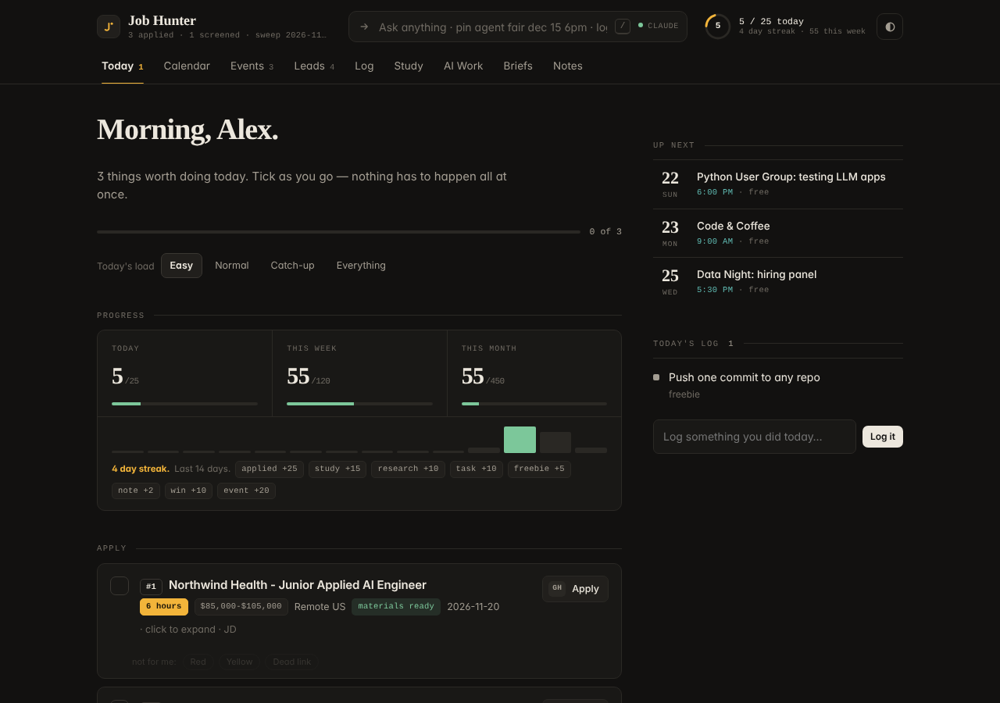
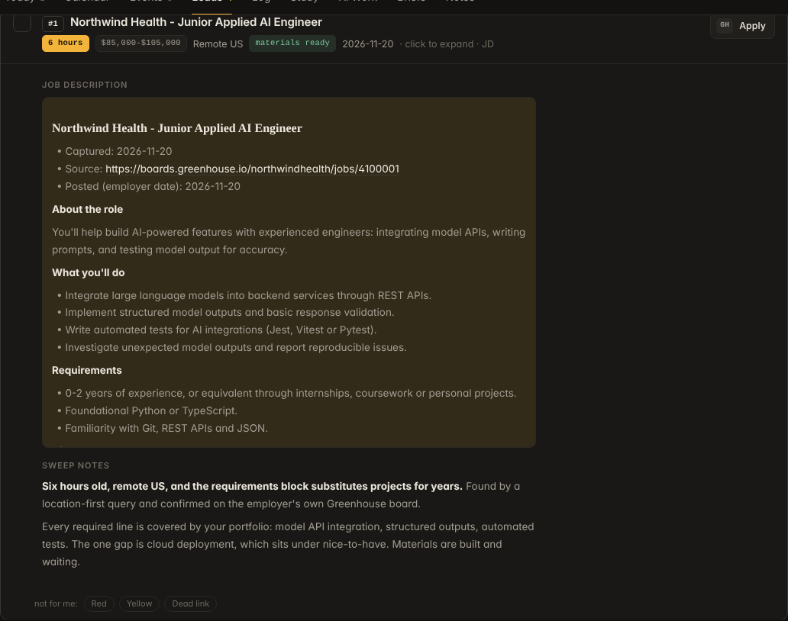
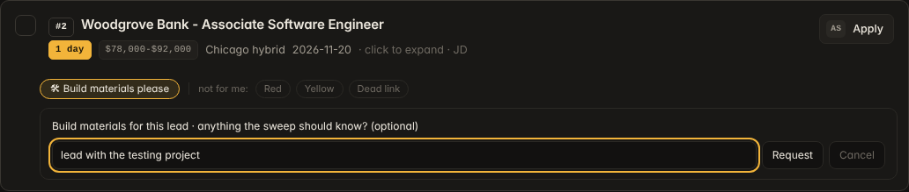
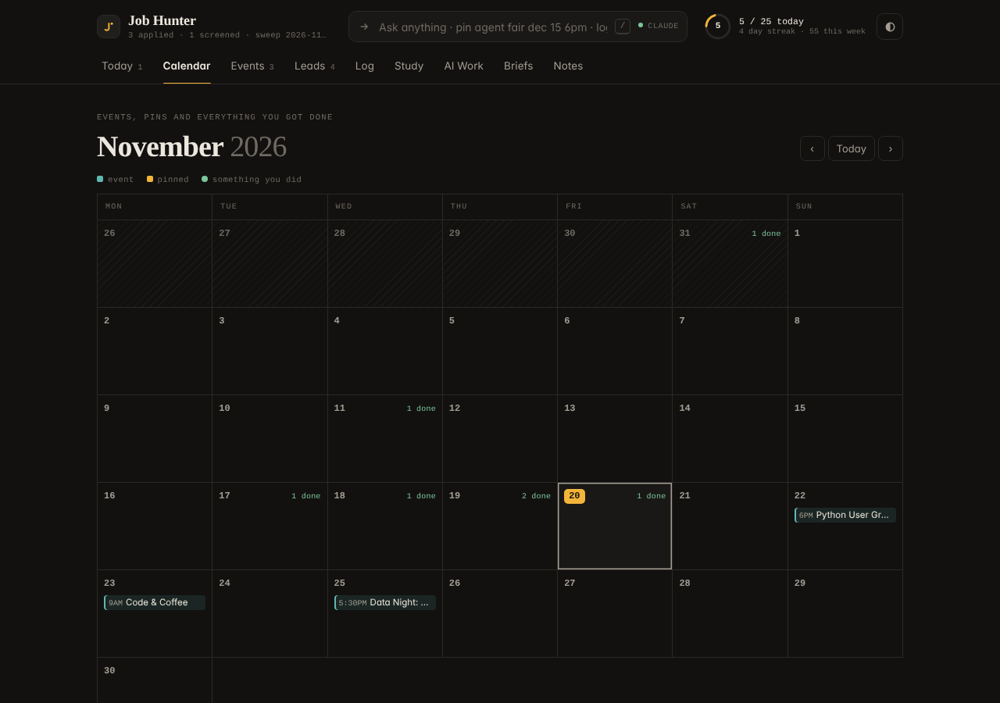

# Daily-Job-Hunter

Most cold applications get ghosted, and the rest come with no feedback. You spend hours on aggregator sites that reshuffle dead listings and write the same materials from scratch over and over.

This plugin handles the slog inside Claude Cowork. It finds live postings on the boards that actually work for your situation, checks every one against the employer's own site, drafts tailored resumes and outreach, and learns over time which sources produce real leads versus noise. You wake up to a ranked brief on a local dashboard, with apply links and materials ready. You read, send what you want, and tell the system what stuck and what was a scam.

It writes drafts. You ship them.



<table>
<tr>
<td width="50%"><br><sub>Every lead opens to its job description, saved from the employer's own posting, with the sweep's analysis underneath.</sub></td>
<td width="50%"><br><sub>One tap builds the resume and apply notes for a lead, right away if Claude Code is installed.</sub><br><br><br><sub>Events, pins, and a mark for every day you got something done.</sub></td>
</tr>
</table>

<sub>Screenshots use mock data.</sub>

**Contents:** [What you get](#what-you-get) · [Quick start](#quick-start) · [The dashboard](#the-dashboard) · [How it works](#how-it-works) · [Guardrails](#how-it-avoids-confidently-wrong-output) · [board_poller](#board_poller--direct-ats-polling-zero-tokens) · [Token cost](#token-cost) · [Files](#files-the-plugin-writes-to-your-workspace) · [Skills](#skills-shipped) · [Changelog](#changelog)

## What you get

**Finding leads**

- Direct ATS polling of your target companies via `board_poller`, no tokens spent
- Boards with karma and tiers — the system learns which sources actually work for you, and parks the quiet ones instead of killing them
- Ghost-burn tracking with three tiers (RED permanent / YELLOW 90 days / GREEN cooled-off)
- Salary-band calibration — comp is read against winnability, so a high-comp lead with no concrete angle (referral, named contact, a JD line your work directly answers) is logged as a stretch instead of taking a top-3 slot
- Autonomous mornings — fresh leads ready when you wake up

**Applying**

- Tailored resume and outreach drafts (with named recruiters when identifiable, never invented). Cover letters are **not** auto-generated — when a role requires one you get a structural outline and an angle, and you write it in your own voice
- Optional email outreach drafts — when a real named contact is found, a ready-to-send email is staged in your drafts folder. Draft only: the plugin never sends, and any reply is yours to handle
- A `CLAUDE.md` template seeded with battle-tested job-hunt rules (resume tightness, JD-quote-verbatim, provenance tiers, flex-skill strategy, recruiter-direct outreach play, scam patterns)

**Staying on top of it**

- Numbered applied tracking with a daily pending count and study-nudge prompts after dry streaks
- Optional email tracking (connect an account like Gmail) — the midday pass reads confirmations and rejections and keeps `applied.md` current, read-only
- Frequency-tallied skill-gap log with concrete study paths (CodePath, Advent of Code, LeetCode, project ideas with expansion routes, language and Linux resources)
- A local dashboard: today's short list, every lead with its job description, one-tap kill and build buttons, a calendar, and a points/streak tracker

## Quick start

> **Read before installing.** This plugin generates AI-written drafts. AI hallucinates. Resume tailorings and outreach are templates, not finished documents — read every one before sending, especially the first ten or twenty while you learn how the model drifts on your background. The full disclaimer is in [`skills/setup/references/disclaimers.md`](https://github.com/reixyz22/Claude-Co-work-Job-Hunter/blob/main/skills/setup/references/disclaimers.md) and is the first thing setup reads to you.

1. Get the `.plugin` file and install it in Cowork. Download it from [Releases](https://github.com/reixyz22/Claude-Co-work-Job-Hunter/releases), or build it yourself from a clone:

   ```
   git clone https://github.com/reixyz22/Claude-Co-work-Job-Hunter.git
   cd Claude-Co-work-Job-Hunter
   git archive --format=zip -o daily-job-hunter.plugin HEAD
   ```

   Use `git archive`, not GitHub's "Download ZIP": the ZIP wraps everything in an extra folder and the plugin then fails to load. `git archive` also packs only tracked files, so your own workspace state never ends up inside a plugin you share.

   

2. Run the `setup` skill in a new chat with / . Claude will ask you for, in order:
   - A workspace folder (state files live there, on your computer, locally — nothing leaves)
   - Name, email, phone, city/state, work authorization, LinkedIn, GitHub (any can be skipped; no street address is ever collected)
   - Career stage, role focus, geography, remote tolerance
   - Your best current resume (PDF or LaTeX)
   - One or more code folders for a read-only skills inventory
   - Two to four projects you'd want to talk about in interviews
   - What you most want to learn next (shapes the skill-gap study suggestions)
   - Companies or industries to filter out (ethics seed)
3. Confirm the scheduled tasks (default 1am + 6am local time, plus a 1pm inbox pass if you connect an email account, and an optional twice-weekly event sweep).
4. Optionally do a dry-run preview.
5. Tomorrow morning, open the dashboard (see [The dashboard](#the-dashboard)) or read `brief-YYYY-MM-DD-6am.md` in your workspace.
6. Tell it when you apply and when you spot a scam, on the dashboard or in your own words. The system depends on this (see [How it works](#how-it-works)).

Setup takes about ten minutes.

## The dashboard

A local web page where the briefs actually get read. Python standard library only: no pip, no node, no build step. It binds to `127.0.0.1`, so nothing is exposed off your machine.

```
python3 tools/brief_site/serve.py          # http://127.0.0.1:8787
```

On Windows, double-click `tools/brief_site/install-autostart.bat` once and it starts hidden every time you log in (`remove-autostart.bat` undoes it). The server restarts itself when its own code changes, so a plugin update never leaves a stale server answering a newer page.

- **Today** shows a short list sized by a load dial (Easy / Normal / Catch-up / Everything), one lead per company, freshest first, never past the freshness cutoff. Progress, a streak and low-effort "freebie" tasks sit beside it on purpose: a bad day should still end with something ticked.
- **Leads** open to the job description first, saved verbatim from the employer's posting, with the sweep's analysis as a separate section under it.
- **Kill buttons** on every card: **Red** (permanent), **Yellow** (three months), **Dead link**. Quiet until you hover.
- **Build materials please**, with an optional note, on any lead without materials. If the [Claude Code](https://code.claude.com/docs/en/setup) CLI is on your PATH, it builds the folder **right now**: an unattended `claude -p` run in your workspace with a restricted tool list, your `CLAUDE.md` rules loaded automatically, and the card flips from "Building now" to "materials ready" when the files land. Resume PDFs need a LaTeX compiler on the same machine (MiKTeX on Windows: `winget install -e --id MiKTeX.MiKTeX`, then `initexmf --set-config-value [MPM]AutoInstall=1` so missing-package prompts can't stall an unattended run). Without the CLI, or if a build fails, the request waits for the next scheduled sweep. It never applies or submits anything.
- **Calendar** shows events from the event finder, your own pins, and every day you got something done.

**How the clicks reach the pipeline.** The web server never writes your markdown files. Every click appends one fsync'd line to `state/events.jsonl`; the next sweep runs `drain_queue.py`, which writes applications into `applied.md`, kills into `ghost.md`, and notes and build requests into `dashboard-inbox.md`. Draining is idempotent, so a skipped run or a shut-down laptop costs latency and nothing else. Design notes in [`tools/brief_site/README.md`](tools/brief_site/README.md).

Personal settings (your name for the greeting, companies to deprioritize, preset kill reasons, a line of context for the ask bar) go in `tools/brief_site/config.json`, which is gitignored. Copy `config.example.json` to start.

## How it works

Up to three scheduled passes a day, plus an optional event sweep. Your computer needs to be on or set to wake at the scheduled times.

**Overnight (1am)** runs discovery across three parallel layers — direct ATS polling of your registered target companies, broad source-biased search, and location-first freshness search — then scam-screens, ranks, and builds tailored materials for the best lead.

**Morning (6am)** verifies every apply link on the employer's own API, runs its share of the search (the two runs split the query load), and writes the brief you read with coffee, then publishes it to the dashboard.

**Midday (1pm, optional)** scans your inbox. Job-alert email reaches companies no board rotation queries, so it is a discovery channel in its own right — and it is the only channel that reports back on applications you already sent, which is what keeps `applied.md` from drifting out of date.

**Twice weekly (`event-finder`, WIP)** looks for in-person events worth your time — hiring events with a published employer roster, user groups that meet inside company offices, hackathons — and ranks them by who is in the room rather than by how the event looks. It never registers you for anything.

Every pass reads your `applied.md` and `ghost.md` first to skip anything you've already touched. Each source carries a karma score that climbs when leads work out and decays back toward neutral when they don't, and tiers (CORE / ROTATION / DORMANT / BLOCKED) keep a quiet week from burying a good board permanently.

**You're a participant, not a passenger.** The system needs to hear when you apply to a role and when you spot a scam or a dead listing. Tick it on the dashboard or say it in your own words ("I applied to Acme," "skip Beta for a few months"). Without it, the same leads get recycled. Five minutes a week is enough.

## How it avoids confidently wrong output

Early versions produced briefs that read perfectly and were wrong — inflated project metrics, requirements attributed to postings that never listed them, and "no alert arrived from X" lines written off a search that had silently truncated. Four rules fixed it, and they live in the plugin's standing-rules template rather than in anyone's memory:

- **Metrics are read, not recalled.** `skills-inventory.md` is the source of truth for what you can claim, and the resume can't claim what it can't back. See [*no fabricated experience*](https://github.com/reixyz22/Claude-Co-work-Job-Hunter/blob/main/skills/setup/references/claude-md-template.md).
- **Requirement text is quoted verbatim** from the posting. If the JD says "C# or Java," the agent may not add Python.
- **Every claim carries a provenance tier** — ALERT (from a job-alert email), REPORTED (from a named third party), CONFIRMED (read on the employer's own ATS) — and the tiers never merge into one confident voice. A lead that is only ALERT-tier is a normal discovery, not a defect, and it gets labeled as such instead of being dressed up or thrown away.
- **Scam and mirror-mill screening runs before anything else** — redirect aggregators, republished dead listings under fabricated dates, and training-repayment (TRAP) outfits. Patterns documented in [`examples.md`](https://github.com/reixyz22/Claude-Co-work-Job-Hunter/blob/main/skills/setup/references/examples.md).

The same instinct shows up in the tooling: `tools/board_poller/README.md` labels its own ATS endpoint table *unverified — written from recall, not vendor documentation*, and the `--add` command probes each board live before registering it. That is where the guess gets tested.

## board_poller — direct ATS polling, zero tokens

`tools/board_poller/` is a stdlib-only Python tool (no `pip install`) that polls company ATS boards directly — Greenhouse, Lever, Ashby, Workday, SmartRecruiters, Workable, Rippling, plus an HTML fallback — and reports only what is **new** since the last run.

```
python3 poll_boards.py --add "<your filtered ATS careers URL>"   # register a company
python3 poll_boards.py --run                                     # diff since last run
python3 poll_boards.py --standing                                # everything currently open
python3 -m unittest test_poll_boards                             # 38 offline unit tests
```

The keyword filter is the small half of it. The **diff** is the point: `seen.json` remembers every posting ID ever fetched, so each run surfaces only what appeared since last time — which is how a posting a few hours old gets caught, the strongest ranking signal the pipeline has.

Your `registry.json` (target companies) and `seen.json` are gitignored; `registry.example.json` documents the shape. `REGISTRY-RECOVERY-2026-08-13.md` is the postmortem from the day a cleanup one-liner assumed `boards` was a list when it is a dict and wiped 61 board configs — kept in the repo because the prevention notes are the useful part.

## Token cost

The Claude Pro plan ($20/month as of May 2026) is enough to run the full system comfortably. The free tier's daily token limit will hit before the morning brief completes.

**The binding constraint on search volume is the context window, not your token allowance.** Each web-search call returns roughly 7,000 tokens of result text that then sits in the session for the rest of the run, so a sweep that fires 50 searches inline spends most of its window on raw results and has nothing left for verification and write-up. It degrades quietly, re-serving stale leads and mis-ranking.

The sweeps handle this by running searches in **subagent batches** — 5-8 queries per subagent, `numResults: 5`, and the subagent returns only a compact survivor list (employer, role, verbatim experience requirement, employer ATS link, dated provenance, and which query found it). The raw result text is spent in the subagent's context and never enters the parent sweep's. That is what makes a 40-50 query sweep reachable without quality loss. Full protocol in `skills/nightly/SKILL.md` STEP 1.

If a sweep under-delivers, it names which resource ran out: rate limit, token budget and context window are three different failures with three different fixes.

## Files the plugin writes to your workspace

```
<your-workspace>/
├── CLAUDE.md                      # standing rules + your project memory
├── profile.md                     # name, contact, work auth, targeting, learning interest
├── profile-resume.md              # parsed structure of your resume
├── profile-projects.md            # 2-4 interview-worthy project narratives
├── skills-inventory.md            # what your code shows you can do
├── boards.md                      # karma table + tiers + denylist + event log
├── ghost.md                       # RED/YELLOW/GREEN dead listings
├── applied.md                     # numbered application log
├── alert-channels.md              # which email senders are real channels
├── pattern-signals.md             # what you engage with vs. ignore
├── posting-freshness.md           # timestamp log
├── skills-to-learn.md             # tallied gaps + study paths
├── brief-YYYY-MM-DD-1am.md        # overnight research handoff
├── brief-YYYY-MM-DD-6am.md        # daily output (the dashboard reads these)
├── dashboard-inbox.md             # notes and build requests from the dashboard
├── jds/                           # saved job descriptions for every surfaced lead
├── email-check-YYYY-MM-DD-1pm.md  # midday inbox pass (if email connected)
├── events.md                      # in-person event log, kills included (event-finder)
└── applications/<slug>-YYYY-MM-DD/
    ├── jd.md
    ├── apply-notes.md
    ├── outreach-draft.md
    └── resume.pdf (+ source)
```

## Skills shipped

| Skill           | When                 | Purpose                                                       |
| --------------- | -------------------- | ------------------------------------------------------------- |
| `setup`         | Once, on install     | Onboarding wizard — disclaimers, profile, resume, code scan, schedule |
| `nightly`       | Auto, weekday 1am    | Overnight research + materials for top lead                   |
| `morning-brief` | Auto, weekday 6am    | Verify links, fill gaps, deliver the daily brief              |
| `email-check`   | Auto, weekday 1pm    | Inbox pass — mine job alerts, reconcile `applied.md` (needs an email connector) |
| `event-finder`  | Auto, twice weekly   | **WIP** — in-person events ranked by who is in the room: hiring events, user groups, hackathons |

## Changelog

**0.3.4** — Added **the dashboard** (`tools/brief_site`): a local, stdlib-only web front end for the briefs with a Today list, expandable leads, calendar, study and points tabs, and an append-only event log that the sweeps drain, so clicks survive a closed laptop and skipped runs. Expanded leads now show the **job description first** and the sweep's notes under it; both sweeps save a JD file for every lead they surface. New **Build materials** button with an optional note: with the Claude Code CLI installed it builds the application folder immediately on your machine, otherwise the next sweep builds it first. Red / Yellow / Dead-link kill buttons write to `ghost.md` through the same queue. Windows autostart (`install-autostart.bat`) and a self-restarting server. Fixed a parser bug that marked every "NOT BUILT" lead as ready, and the morning brief is now written as `brief-YYYY-MM-DD-6am.md` with a fixed table header so the dashboard always picks it up.

<details>
<summary>Earlier releases (0.1.0 to 0.3.3)</summary>

**0.3.3** — Added a **Rippling ATS adapter** to `board_poller`. Rippling was an unrecognized vendor, so `--add` rejected its URLs outright and every Rippling-hosted employer was unpollable by construction, which is a harder failure than the usual "nobody registered it yet." It is not a niche vendor either: three employers already in one user's own application history run on it. The public board endpoint takes no auth and returns a flat array the poller already knows how to normalize. One caveat is documented and asserted in a test: Rippling ships **no posting date**, so `posted` stays empty and age can only come from the seen-diff. A test fails if a future change starts inventing one, since a fabricated age would promote dead reqs straight to the top under freshness-first ranking. Suite is 18 → 22 tests.

**0.3.2** — Every application folder now captures `jd.md`, the posting's body text plus the application form's own free-text questions, written before any other artifact and used as the source for the materials. Postings come down within weeks; once one does, every JD quote in the apply notes is unverifiable, screens that land later have no requirements text to prep against, and there is no way to tell which of two similarly-titled sibling reqs was actually applied to. Also documents where resume content may be copied from: reuse is correct, but the source must be the user's own words, their repos, their baseline resume, the canonical template, or a build that actually reached a screen. Pulling from an arbitrary prior folder inherits that session's unreviewed mistakes. Added a standing instruction to audit the resume blocks that never change, since tailored sections are self-verifying and boilerplate is not, which is where a wrong line can sit for months.

**0.3.1** — Search now runs in **subagent batches** (5-8 queries per subagent, `numResults: 5`), with the subagent returning only a compact survivor list and the raw result text never entering the parent sweep's context. The problem this fixes: each search call returns ~7,000 tokens that persist for the rest of a run, so an inline 40-50 query sweep spent its whole window on raw results and then degraded quietly — re-serving stale leads and mis-ranking — while reporting the shortfall as a token or rate limit. It was neither; it was the context window, and the three are now documented as distinct failures a sweep must tell apart before reporting one. Subagents return findings only and never rank, never decide, and never write to tracking files; their returns are not kill-checked against `applied.md` / `ghost.md`, so the parent sweep still runs that itself. Query load is now split across the nightly and morning runs (20-25 each) instead of the morning run doing a token freshness pass, and both runs report their real query count.

**0.3.0** — Added the `event-finder` skill (**work in progress**): a twice-weekly sweep for in-person events, ranked by whether the hiring side is actually in the room and whether you can actually get in, with the kill log kept so later runs don't re-chase dead ends. The ranking model is settled; the per-city source registry is still hand-seeded. Fixed the install instructions — building the `.plugin` with GitHub's "Download ZIP" produces a wrapper folder that stops the plugin loading, so the README now uses `git archive`. Added the `email-check` skill: the midday inbox pass, previously run as an ad-hoc scheduled task, now ships as a documented skill. It mines job-alert email as a discovery channel and reconciles `applied.md` against real confirmations, rejections and interview invites. Two mandatory search passes (the second one deliberately includes Promotions, where alert digests are routinely classified and where a single-pass scan cannot see them), and a hard rule against asserting a negative from a result set that hit its page cap. Added `tools/board_poller`, a stdlib-only Python ATS poller with 18 offline unit tests. Discovery in `nightly` now runs three layers in parallel rather than treating any one as primary — the 2026-08 "poller-primary, web-search-supplement" framing starved the pipeline for two weeks and is retired. Cover letters dropped as an auto-generated deliverable. Board karma is now clamped and decays, with CORE/ROTATION/DORMANT/BLOCKED tiers so a dry week parks a source instead of burying it.

**0.2.0** — Added optional email-connector integration (e.g. Gmail via Cowork). When connected: the pipeline can search your inbox for application confirmations and rejections and keep `applied.md` current without manual copy-paste, and the nightly pass can stage a real outreach email as a draft in your account when a good named contact is found. Both capabilities are strictly read/draft-only — no send capability is ever used, and replies are never auto-answered. Entirely optional; the plugin works the same without it.

**0.1.1** — Setup no longer asks for a street address, just city/state (or city/country) — resumes and geo-matching never needed more than that, and asking for it was a privacy overreach. Added salary-band calibration to the nightly research pass so high-comp leads get ranked by winnability, not just by the number.

**0.1.0** — Initial release.

</details>

## Author

Built by William Reixyz Pitts ([github.com/reixyz22](https://github.com/reixyz22)).

## License

MIT. See `LICENSE`.
